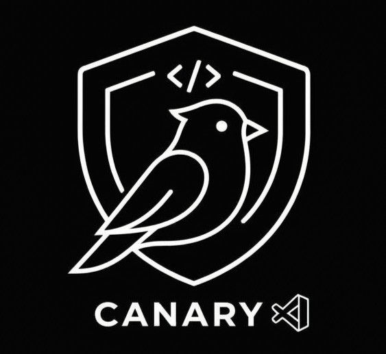

<p align="center">
  
</p>

<h1 align="center">Canary</h1>

<p align="center">
  <em>O canário na mina de carvão: um aviso antecipado quando uma dependência do seu projeto tem vulnerabilidade conhecida.</em>
</p>

Canary é uma extensão para VS Code que analisa as dependências do workspace e aponta vulnerabilidades
diretamente no editor. Ela consulta a base pública [OSV.dev](https://osv.dev), que é gratuita e não
exige login nem chave de API.

## Gerenciadores suportados

| Gerenciador | Arquivos lidos | Transitivas | Workspaces |
|---|---|---|---|
| **npm** | `package.json`, `package-lock.json` (v1, v2, v3) | ✅ | ✅ |
| **pnpm** | `package.json`, `pnpm-lock.yaml` (5.x, 6.x, 9.x) | ✅ | ✅ |
| **uv** | `pyproject.toml`, `uv.lock` | ✅ | ✅ |
| **pip** | `requirements*.txt` | — | — |

Projetos Python que seguem o PEP 621 sem `uv.lock` (hatch, pdm, setuptools) também são analisados
pelo `pyproject.toml`, com versões aproximadas.

## Recursos

- **Alertas no editor:** cada dependência vulnerável fica sublinhada na linha em que é declarada. A cor
  depende da severidade: vermelho para crítica ou alta, amarelo para média, azul para baixa. O alerta
  mostra o ID do advisory, com link, e a versão que corrige.
- **Quick Fix** (`Ctrl+.`):
  - troca a versão no manifesto pela menor que corrige todas as vulnerabilidades conhecidas do pacote,
    mantendo o prefixo `^` ou `~` que estava antes;
  - no uv, roda `uv lock --upgrade-package <pacote>` no terminal, o que funciona também para
    dependências transitivas;
  - abre a página do advisory.
- **Painel lateral** (ícone do canário na barra de atividades, à esquerda): pacotes vulneráveis ordenados por severidade,
  com as vulnerabilidades de cada um.
- **Contador na barra de atividades:** o ícone do canário mostra quantos pacotes têm vulnerabilidades;
  o tooltip traz também o total de vulnerabilidades. Sem achados, o contador some.
- **Barra de status:** total de vulnerabilidades, com cor de alerta conforme a pior severidade.
- **Verificação automática** ao abrir o workspace e sempre que um manifesto ou lockfile muda, inclusive
  depois de `npm install`, `pnpm install` ou `uv lock`.
- **Monorepos:** em workspaces npm, pnpm ou uv, as dependências diretas de cada projeto apontam para o
  próprio `package.json` ou `pyproject.toml`, e nenhum pacote é contado duas vezes.

## Comandos

| Comando | Descrição |
|---|---|
| `Canary: Verificar vulnerabilidades` | Analisa o workspace agora |
| `Canary: Limpar resultados` | Remove os alertas e esvazia o painel |

## Configurações

| Chave | Padrão | Descrição |
|---|---|---|
| `canary.scanOnStartup` | `true` | Verifica ao abrir o workspace |
| `canary.scanOnChange` | `true` | Verifica de novo quando manifestos ou lockfiles mudam |
| `canary.includeDevDependencies` | `true` | Inclui dependências de desenvolvimento (`devDependencies`, `[dependency-groups]`, `tool.uv.dev-dependencies`) |
| `canary.exclude` | `**/{node_modules,.venv,venv,.git,dist,out,build}/**` | Pastas ignoradas na busca por manifestos |
| `canary.ignorePackages` | `[]` | Pacotes que não são analisados nem enviados à OSV.dev (veja abaixo) |

### Ignorando pacotes internos

Use `canary.ignorePackages` para que pacotes privados nunca saiam da sua máquina. Os padrões aceitam `*`
e um prefixo opcional de ecossistema (`npm:` ou `pypi:`):

```jsonc
// .vscode/settings.json
{
  "canary.ignorePackages": [
    "@minhaempresa/*",      // qualquer ecossistema
    "npm:internal-*",       // só npm
    "pypi:minhaempresa-*"   // só PyPI
  ]
}
```

Em pacotes Python, os nomes são comparados já normalizados (PEP 503): `pypi:Minha_Empresa-*` também casa com
`minha-empresa-core`. A comparação ignora maiúsculas. O canal **Canary** do painel *Output* mostra quantos
pacotes foram ignorados em cada verificação.

## Segurança e privacidade

**O que é enviado para fora:** só o nome, a versão e o ecossistema de cada dependência, para
`https://api.osv.dev` (mantida pelo Google), por HTTPS. Código, caminhos de arquivo e nome do projeto não são
enviados. Não há telemetria, login nem outros servidores. Pacotes listados em `canary.ignorePackages` são
filtrados antes da consulta.

**O que a extensão faz no seu ambiente:**

- Lê os manifestos e lockfiles como texto ou JSON; nunca executa código do projeto nem roda gerenciadores de
  pacotes por conta própria.
- Não tem dependências em tempo de execução: o pacote contém apenas o código da própria extensão.
- Só altera arquivos quando você aplica um Quick Fix, e a alteração pode ser desfeita com `Ctrl+Z`.
- A única ação que roda um comando (`uv lock --upgrade-package`) só aparece em pastas confiáveis, valida o
  nome do pacote contra o padrão do PyPI e exige que a pasta do projeto esteja dentro do workspace.
- Versões corrigidas vindas da OSV.dev são validadas antes de serem escritas num manifesto.

**Workspace Trust:** em pastas não confiáveis (Modo Restrito), o Canary continua analisando e mostrando os
alertas, porque isso é só leitura, mas desativa a ação que roda comandos no terminal.

**O que o Canary não garante:** a ausência de alertas não significa ausência de vulnerabilidades. A extensão só
conhece o que está catalogado na OSV.dev. Ela alerta sobre pacotes maliciosos já conhecidos (IDs `MAL-…`), mas
não detecta ataques novos. Use-a como primeira linha de defesa, junto com `npm audit`, Dependabot e revisão de
código.

## Desenvolvimento

Requisitos: Node.js 18 ou superior e VS Code 1.85 ou superior.

```bash
npm install
npm run compile      # ou: npm run watch
```

Para rodar a extensão:

1. Abra esta pasta no VS Code e pressione **F5**.
2. Na janela *Extension Development Host*, abra a pasta `sample-workspace/`.
3. Veja os alertas no painel *Problems*, no ícone do canário e na barra de status.

Os logs ficam no canal **Canary** do painel *Output*.

Teste rápido sem abrir o VS Code (lê os projetos de exemplo e consulta a OSV.dev de verdade):

```bash
npm run smoke
```

### Projetos de exemplo

A pasta `sample-workspace/` tem um projeto por gerenciador, todos com pacotes vulneráveis de propósito:

| Pasta | Gerenciador | Destaques |
|---|---|---|
| `node-app/` | npm | `lodash`, `express`; transitivas `qs` e `path-to-regexp` |
| `pnpm-app/` | pnpm (workspace) | `axios`, `@babel/traverse` em `packages/web`; transitiva `qs` forçada com `overrides` |
| `uv-app/` | uv | `jinja2`, `flask`; transitiva `urllib3` forçada com `constraint-dependencies` |
| `py-app/` | pip | `requests`, `django`, `urllib3` |

### Gerar o pacote `.vsix`

```bash
npm run package
code --install-extension canary-0.1.0.vsix
```

## Estrutura

```
src/
  extension.ts       ativação, comandos, alertas, Quick Fix, barra de status
  tree.ts            painel lateral
  osv.ts             cliente da OSV.dev (consulta em lote e detalhes, com cache)
  parsers/npm.ts     package.json e package-lock.json
  parsers/pnpm.ts    pnpm-lock.yaml
  parsers/uv.ts      pyproject.toml e uv.lock
  parsers/python.ts  requirements*.txt e leitura de specs PEP 508
  version.ts         comparação e extração de versões
  security.ts        validação de nomes e versões, filtro canary.ignorePackages
  types.ts           tipos compartilhados
scripts/smoke.js     teste rápido fora do VS Code
sample-workspace/    projetos de exemplo
media/
  canary-icon.jpg    logo original (1024×1024, fora do pacote .vsix)
  canary-icon2.jpg   logo usado no README
  icon.png           ícone da extensão no Marketplace (256×256, recorte do logo)
  canary.svg         ícone da barra de atividades (traço monocromático, 24×24)
```

O ícone da barra de atividades precisa ser um SVG monocromático e transparente, porque o VS Code o usa
como máscara e o pinta com a cor do tema. Por isso ele é uma versão simplificada do logo, sem o texto e
sem o `</>`.

Os parsers não dependem da API do VS Code e não usam bibliotecas externas. Eles leem os arquivos linha
a linha para guardar a posição exata de cada dependência, que é usada pelos alertas e pelo Quick Fix.

## Limitações conhecidas

- **Sem lockfile**, a versão é estimada pela faixa declarada (`^4.17.0` vira `4.17.0`); o alerta avisa
  quando isso acontece.
- **`requirements.txt`:** só `==`, `>=` e `~=` são analisados. Linhas sem versão, `-r` e URLs são ignoradas.
- **Transitivas no npm e no pnpm** não têm Quick Fix. A correção é atualizar o pacote que as traz ou usar
  `overrides` (no npm, em `package.json`; no pnpm, em `pnpm-workspace.yaml`).
- **uv:** `uv lock --upgrade-package` só resolve quando as restrições do `pyproject.toml`, inclusive
  `constraint-dependencies`, permitem a versão corrigida.
- **Pacotes fora de registry** (git, URL, caminho local) não são consultados.
- **Ainda não suportados:** `yarn.lock`, `poetry.lock` e `Pipfile.lock`.
- A comparação de versões é simplificada: cobre semver e os casos comuns do PEP 440.
- A versão sugerida às vezes pula para outra versão principal (por exemplo, Django 3.x → 4.2.x) quando a
  série atual não recebeu correção.

## Próximos passos

- Suporte a `yarn.lock`, `poetry.lock`, `Pipfile.lock`, `go.mod`, `pom.xml` e `Cargo.lock`.
- Quick Fix com `overrides` para transitivas do npm e do pnpm.
- Cache persistente para funcionar offline.
- Mostrar a cadeia de dependências das transitivas (quem traz o pacote).
- Exportar relatório (JSON ou SARIF) e um modo CLI para CI.

## Licença

[MIT](LICENSE.md) © 2026 eduardo239
